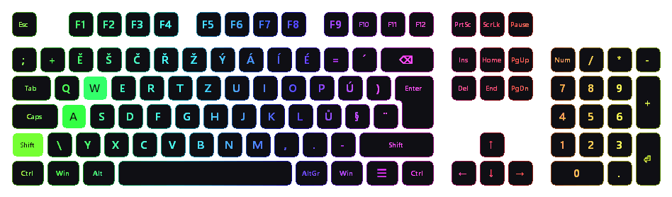
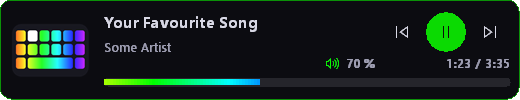
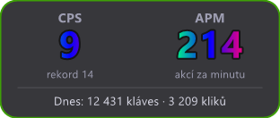
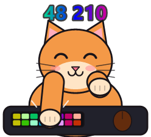
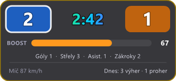
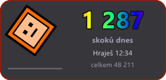
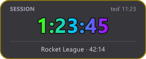
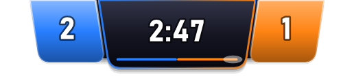
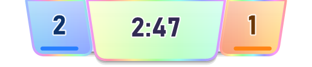
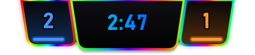

# Keyboard Sound

Click sound on every key press + an RGB keyboard & mouse overlay that lights up the keys you press.
Works on Windows 10/11, in games too (borderless / windowed fullscreen).

**🌐 Website with live demo: https://pepepep2323.github.io/keyboard-sound**



  

  

  

## Download

**[⬇ Download KeyboardSound.zip](../../releases/latest)**. Unzip it and run `KeyboardSound.exe`.

If Windows says *"Windows protected your PC"*, click **More info → Run anyway** (the app is not code-signed).

## Features

- 🔊 **3 click sounds** (Creamy 1/2/3) or **your own** (wav, mp3, m4a, ogg, flac, wma), volume control
- 🌈 **5 light effects**: rainbow wave, static light, breathing, ripple from key, only pressed keys
- 🎨 **10 colors**: rainbow or a single color
- ⌨️ **3 keyboard looks**: RGB, pastel, normal black
- 🧩 **Separate widgets** you can move, resize and hide one by one: keyboard, mouse, music player, stats, cat,
  your own **texts** and **images** (animated GIFs too)
- 📊 **Stats**: CPS (clicks per second) with your record, APM, today's keys and clicks
- 🐱 **Clicking cat** that taps along with your keyboard and mouse and counts every press
- ⏱️ **Session timer**: how long you've played, the time, and how long the current game runs
- 🚗 **Rocket League widget**: live score, time, your boost, goals / shots / saves, wins today
  (from the game's official Stats API: nothing is injected into the game)
- 🏆 **Rocket League score counter**: score and time at the top, over the game's own; your team first,
  real team colors, goal animation with confetti, 3 looks (enhanced, pastel RGB, black RGB) and any font
- 🟩 **Geometry Dash widget**: a cube that jumps with you and counts your jumps
- 🎵 **Music control** (Spotify, YouTube, …): player panel with cover, title, volume and a clickable progress bar,
  shortcuts to play/pause, skip, seek and change the **music volume** (only the music app, not the game) —
  change them however you like
- 🔇 **Spotify ads muted automatically** (they can't be skipped, so they're silenced)
- 🔉 **Click volume** 10 – 200 % (`Ctrl+Alt+PgUp / PgDn`), click sound on mouse buttons too (off by default)
- 🔥 **Rocket League boost meter** in your team color, same look / font / opacity as the score counter
- ⚙️ **Main menu**: one window with all settings (click the tray icon)
- 🖌️ **Themes**: 7 looks for all widgets (classic, pastel, black RGB, neon, glass, no background, custom colors),
  any font, and every widget can have its own theme and font
- 🪂 **Fortnite match time** (from the game's log) and 🧰 **chest counter** (reads the SEARCH prompt on screen)
- 💧 **Drink reminder** every 15 – 90 minutes
- ⏰ **Clock** with a timer, 🏷️ **team names** on the score counter, 📡 **OBS** browser source
- 📍 **Back to the original place** for one widget or all of them
- 🖱️ Mouse buttons, wheel and side buttons
- ⌨️ Key labels follow your keyboard layout (e.g. Czech ě š č ř ž)
- 🎮 Doesn't slow games down, clicks go through the overlay
- 🇨🇿 / 🇬🇧 Menus in Czech or English (follows your Windows language)

## Help

Full help: **[NAVOD.txt](NAVOD.txt)** (also inside the ZIP and in the app: menu → Help).

| What | How |
|---|---|
| Main menu (all settings) | Click the keyboard icon near the clock (bottom right) |
| Quick menu | Right-click the keyboard icon near the clock |
| Move / resize widgets | `Ctrl+Alt+F11`, drag each widget, scroll over it to resize, right-click it for options, `Ctrl+Alt+F11` again to finish |
| Turn widgets on / off, add text or image | Menu → Widgets |
| Change sound / effect / color / keyboard look | Menu → Sound / Effect / Color / Keyboard look |
| Rocket League: borderless fullscreen, live data | Menu → Games (close the game first) |
| Your own sound | Menu → Sound → Load your own sound… |
| Music: play / pause | `Ctrl+Alt+↓` |
| Music: next / previous | `Ctrl+Alt+→` / `Ctrl+Alt+←` |
| Music: seek ±10 s | `Ctrl+Alt+Shift+→` / `Ctrl+Alt+Shift+←` |
| Music volume | `Ctrl+Alt+Shift+↑` / `Ctrl+Alt+Shift+↓`, or the mouse wheel over the player |
| Change music shortcuts | Menu → Music → Change shortcuts |
| Hide all widgets | Menu → Show widgets |
| Quit | `Ctrl+Alt+F12` or menu → Quit |

Settings are saved in `%APPDATA%\KeyboardSound`.

## Česky

Zvuk cvaknutí při každém stisku klávesy + RGB klávesnice a myš na obrazovce, které svítí podle toho, co mačkáš.
3 zvuky nebo tvůj vlastní, 5 světelných efektů, 10 barev, pastelová nebo černá klávesnice,
čas hraní a widgety pro Rocket League a Geometry Dash.

1. Stáhni **[KeyboardSound.zip](../../releases/latest)**, rozbal ho a spusť `KeyboardSound.exe`.
2. Když Windows napíše *„Systém Windows ochránil váš počítač“*, klikni na **Další informace → Přesto spustit**.
3. Menu otevřeš pravým klikem na ikonu u hodin. `Ctrl+Alt+F11` přesune klávesnici, `Ctrl+Alt+F12` aplikaci vypne.
   Celý návod je v **[NAVOD.txt](NAVOD.txt)**.

## Run from source

Needs Python 3. The music control also needs the Windows media packages (everything else is the standard library):

```
pip install winrt-runtime winrt-Windows.Media.Control winrt-Windows.Storage.Streams winrt-Windows.Foundation
python keyboard_sound.py
```

- `build.bat` builds the `.exe` (uses PyInstaller)
- `make_icon.py` draws the app icon
- `make_preview.py` renders the overlay pictures for the website
